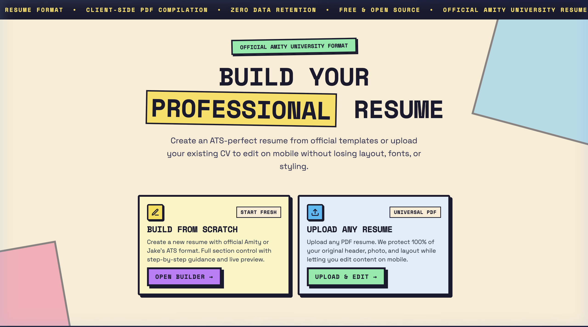
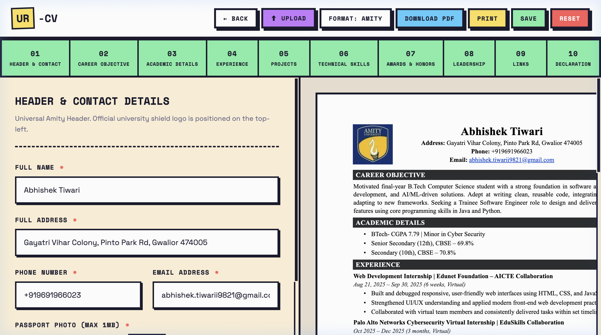
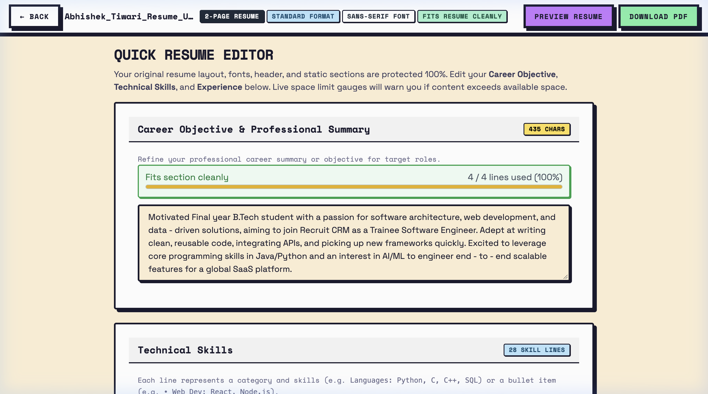
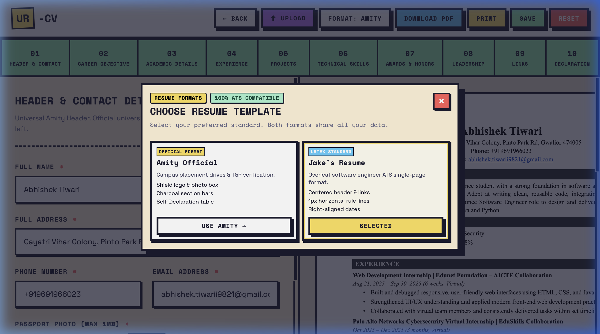

<div align="center">

# ur-CV

**Mobile-First Client-Side Resume Builder & Universal In-Place PDF Editor**

[](https://ur-cv.netlify.app/)
[](LICENSE)
[](https://ur-cv.netlify.app/)
[](https://ur-cv.netlify.app/)

**[Launch Live Application &rarr; https://ur-cv.netlify.app](https://ur-cv.netlify.app/)**

</div>

---

## Overview

**ur-CV** is an open-source, client-side resume application built specifically for editing, creating, and exporting verified resumes **directly from mobile devices on the go**.

Running entirely in the browser without server dependencies or data retention, ur-CV provides two mobile workflows:

1. **Universal PDF Quick Editor**: Upload any existing PDF resume (LaTeX, Canva, Word, Amity). Selectively edit your Career Objective, Technical Skills, and Work Experience from your phone while preserving original fonts, headers, photos, and vector formatting without layout shifts.
2. **Placement & ATS Resume Builder**: Create standardized placement resumes using step-by-step mobile forms for the approved **Amity University Placement CV** and **Jake's ATS Software Engineering Standard**.

---

## Interface Gallery

<details open>
<summary><b>Click to expand or collapse application screenshots</b></summary>
<br>

| Landing Gateway | Split Live Builder |
| :---: | :---: |
|  |  |

| Universal PDF Mobile Editor | Template Switcher |
| :---: | :---: |
|  |  |

</details>

---

## Key Features

- **Mobile-First In-Place PDF Editing**: Modify key sections (Objective, Skills, Experience) on your phone while protecting original headers, bounding boxes, and document styling.
- **Real-Time Space Gauges**: Dynamic line meters calculate available physical space on the page and warn before content exceeds limits.
- **Official Placement & ATS Standards**: Pre-configured formats for Amity University (shield logo, passport box, declaration) and Jake's ATS LaTeX engineering standard.
- **Client-Side Vector PDF Export**: Compiles clean, searchable vector PDFs directly in-browser using jsPDF. Zero data sent to external servers.
- **Integrated Utilities**: In-browser passport photo compressor (under 1MB for placement portals) and responsive zoomable preview modal.

---

## Quick Start

```bash
# Clone the repository
git clone https://github.com/Abhishek09821/ur-CV.git
cd ur-CV

# Install dependencies and launch
npm install
npm run dev
```

Build for production:

```bash
npm run build
```

---

## Tech Stack

- **Frontend**: Vanilla JavaScript (ES Modules), HTML5, Neo-Brutalist CSS
- **PDF Engine**: PDF.js (text extraction & geometry), jsPDF (vector compilation)
- **Deployment & Tooling**: Vite 6, Netlify

---

## License & Author

- **Live Application**: [https://ur-cv.netlify.app/](https://ur-cv.netlify.app/)
- **Author**: [Abhishek Tiwari](https://www.linkedin.com/in/abhishek-tiwari-3a3594300) &middot; [GitHub](https://github.com/Abhishek09821)
- **License**: MIT
